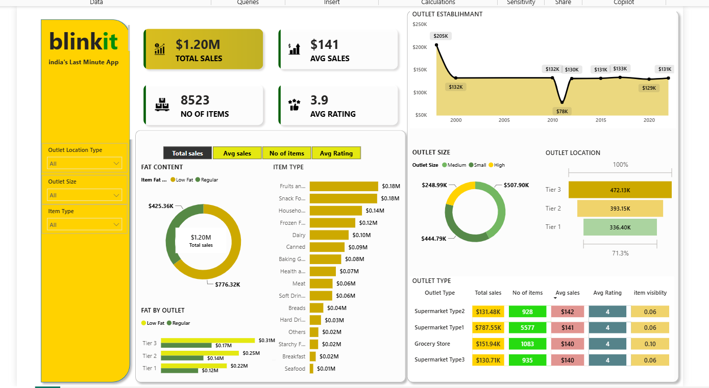

# data-analytics-portfolio
My Data Analytics projects using Excel, Power BI, MySQL and Python
# 👋 Hi, I'm Tharun Kumar

### Aspiring Data Analyst | Bengaluru, India

I'm passionate about Data Analytics and transforming raw data into meaningful business insights.

## 🛠️ Technical Skills

- Microsoft Excel
- Power BI
- MySQL
- Python
- Basic AI Tools

## 📊 My Projects

### 1. Sales Dashboard
- Sales performance analysis
- Business insights and visualization

### 2. Blanket Sales Dashboard
- Sales data analysis
- Dashboard reporting and visualization

## 📚 Currently Learning

- Advanced SQL
- Python for Data Analysis
- Power BI Dashboard Development
- AI Tools

## 🎯 Career Goal

To become a skilled Data Analyst and solve real-world business problems using data.

## 📫 Connect With Me

- Location: Bengaluru, India
- GitHub:
-  https://github.com/TharunKumar-ui-boop

## 📊 Project 1: Blinkit Sales Analysis Dashboard

### Project Overview
An interactive Power BI dashboard designed to analyze Blinkit sales performance and outlet characteristics.

### Key Performance Indicators
- Total Sales: $1.20M
- Average Sales: $141
- Number of Items: 8,523
- Average Rating: 3.9

### Analysis
- Sales by Item Type
- Sales by Fat Content
- Outlet Establishment Trends
- Outlet Size Analysis
- Outlet Location Analysis
- Outlet Type Performance

### Tools Used
- Microsoft Power BI
- Data Visualization
- Data Analysis

### Dashboard Features
- Interactive filters
- KPI cards
- Sales comparison charts
- Outlet performance analysis

### Project Objective
To explore sales performance and understand how product categories and outlet characteristics relate to sales
