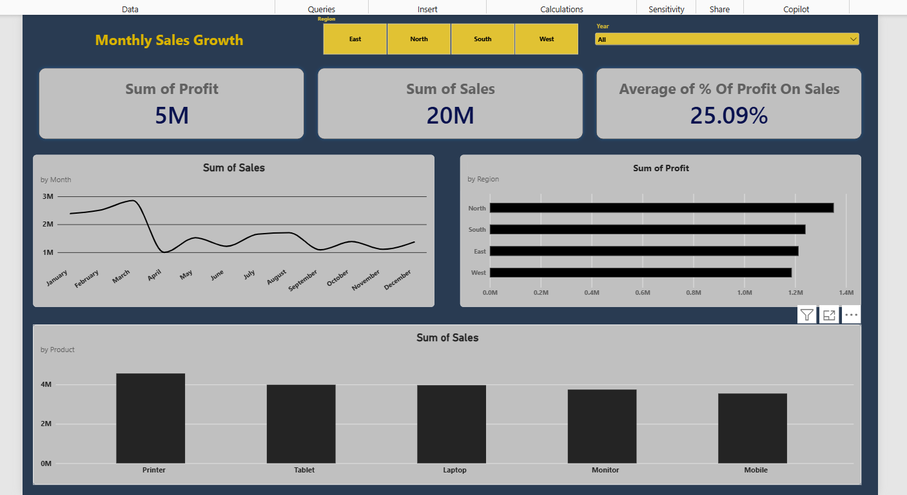

Retail Sales Analysis

Project Overview

This project focuses on analyzing retail sales data to understand sales performance and generate meaningful business insights.

Tools & Technologies

- Microsoft Excel
- Python
- Pandas
- Power BI

Project Workflow

1. Collected and explored retail sales data.
2. Prepared and cleaned the dataset.
3. Performed data analysis using Python and Pandas.
4. Created an interactive dashboard using Power BI.
5. Analyzed sales performance through visualizations.

Project Files

- Retail_Sales_Analysis.pbix
- retail_sales_analysis.ipynb
- Sales dataset files

Objective

To develop practical data analytics skills and understand how data can support business decision-making.

Author

Tharun Kumar

## Dashboard Preview

## Project Overview

This project focuses on analyzing retail sales data to identify sales trends, product performance, and profitability.

The dashboard provides an interactive view of business performance through key metrics and visualizations.

## Key Performance Indicators (KPIs)

- Total Sales: 20M
- Total Profit: 5M
- Average Profit on Sales: 25.09%

## Analysis

- Monthly Sales Growth
- Profit Analysis
- Sales by Product
- Product Performance Comparison
- Monthly Sales Trends

## Tools & Technologies

- Microsoft Power BI
- Data Visualization
- Data Analysis

## Dashboard Features

- Interactive filters
- KPI cards
- Monthly sales trend chart
- Profit comparison chart
- Product-wise sales analysis

## Project Files

- Retail_Sales_Analysis.pbix
- retail_sales_analysis.ipynb
- sales_data.xlsx
- sales_raw_500.xlsx

## Project Objective

To analyze retail sales performance, understand product profitability, and generate meaningful business insights.

## Author

Tharun Kumar
